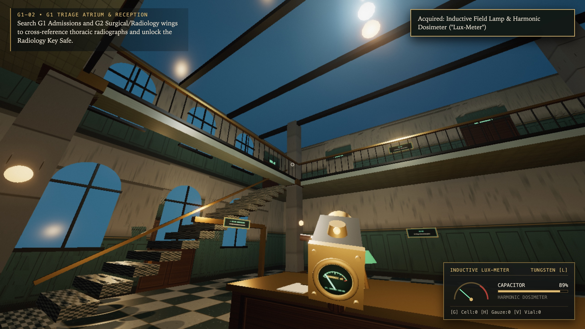

# VESPER WARD

A local first-person survival-horror demo set in St. Damian Thoracic & Somnology Infirmary. You play Mara Solis, a municipal inspector sent to disconnect utilities before demolition. The condemned wards still draw power from an unlisted laboratory below.

Explore five levels, inspect evidence, repair equipment and manage light and noise while evading The Cantor. The game uses Three.js/WebGL2 and locally synthesized Web Audio. Game-specific scenery, textures and effects are authored procedurally; dependency and font origins are listed in [ASSET_PROVENANCE.md](ASSET_PROVENANCE.md).



## How it was made

**One master prompt. Approximately 18 hours of autonomous development.**

- **GPT-6.2 SOL Ultra (Codex)** directed the project, coordinated the implementation, reviewed the code and art, and ran acceptance tests.
- **Gemini 4 Carbon (Gemini Desktop, Task mode)** wrote and revised the game code.

The single master prompt defined the whole project. The agents carried it through implementation, debugging, visual polish, performance tuning and delivery using their own follow-up exchanges and test runs. [Development and verification notes](DEVELOPMENT.md)

## What you play

- Five interconnected floors, 26 named areas, and five physical shortcuts.
- Five main puzzles with archival evidence, item examination and combination.
- The Cantor hunts by sound, sight and light. Use the Lux-Meter, hiding spots, decoys and locked doors to stay alive.
- Twenty archive entries and a playable finale. The first-time play target is 50–60 minutes and awaits a blind human playtest.

## Install, build and launch

Use Node.js 22 and npm. The local development toolchain is Node **22.23.3** / npm **10.9.9**. A current desktop browser with WebGL2, Web Audio and hardware acceleration is recommended. Host-specific renderer and performance results belong in the acceptance report.

Run these commands inside this new project only:

```sh
git clone https://github.com/MichaelCao1/vesper-ward.git
cd vesper-ward
npm ci
npm run build
npm run preview
```

Open **[http://127.0.0.1:4175/](http://127.0.0.1:4175/)**. Keep the terminal server running while playing. `npm run build` type-checks the source and creates the production files in `dist/`; `npm run preview` serves that production build.

For development, use `npm run dev` instead of `npm run preview`. Both scripts bind to **127.0.0.1:4175** with `--strictPort`; run one server at a time. Stop a foreground server with `Ctrl+C`. Source changes require another `npm run build` before production preview reflects them.

The first `npm ci` needs the packages available from npm or its local cache. After dependencies are installed, building and serving locally requires no cloud backend, account, API key, font CDN or remote runtime asset download. Open the HTTP URL rather than double-clicking `index.html` or a `dist/` file with `file://`.

## Controls

| Action | Controls |
|---|---|
| Move / strafe | `W A S D` or arrow keys |
| Look | Mouse after clicking the game canvas |
| Keyboard look left / right | `[` / `]` |
| Keyboard look up / down | `=` / `-`, or `Page Up` / `Page Down` |
| Sprint | Hold either `Shift` |
| Crouch | `C` toggles; either `Ctrl` holds crouch |
| Lean left / right | Hold `Q` / `E` |
| Interact / use / enter or leave hiding | `F` or left click |
| Cycle lamp: off → tungsten → ruby | `L` or right click |
| Recharge the lamp's dynamo | Hold `R` — the ratchet makes noise |
| Use a silent capacitor cell | `G`, or the inventory use button |
| Use gauze | `H`, or the inventory use button |
| Throw a distraction vial | `V` or middle click |
| Open / close the field dossier | `Tab` or `I` |
| Open the facility map | `M` |
| Pause / close current panel | `Esc`; from item examination, returns to the dossier |

In menus, use the mouse or `Tab` / `Shift+Tab` and `Enter`. Text input fields receive typed puzzle input. Close a field or panel before using movement keys. The in-game Controls reference is available from the title and pause menus.

## Starting your inspection

Find the Triage Field Kit early and read nearby maintenance instructions. The Lux-Meter offers a longer tungsten beam, a dim ruby mode and a hand dynamo. Cells provide a silent recharge; the dynamo remains available when cells run out. The harmonic needle reacts to nearby wiring and threat activity.

Use the dossier to review collected documents, examine equipment in 3D and combine compatible components. Turn items to inspect their other faces. The facility map tracks your position, room codes and connectors. Yellow conduit, red pipes, green exit plaques and brass fittings provide environmental clues.

Doors, hiding places, vials and pneumatic buzzers provide ways to manage encounters. Break sightlines before hiding. Closed unlocked doors delay pursuit. The Security Rotunda and designated observation refuge provide breathing room to read. Use tape recorders to save. An injury slows Mara; gauze or a safe-haven respite restores her condition.

Exposed puzzle panels and individual document/reel panels keep the world active. Close a panel with `Esc`, then press `Esc` again to open Pause when you need an interruption. The field dossier and close-up item examiner suspend world simulation in the current implementation.

Unbolt the maintenance hatch from B2 to open a ladder route to B1. The main service stair is also available.

Puzzle solutions and the full ending sequence are kept in the **developer spoiler document** [WORLD_AND_OBJECTIVE_MAP.md](WORLD_AND_OBJECTIVE_MAP.md).

## Saves and recovery

Automatic checkpoints are written at arrival and progression milestones. Manual tape recorders are located at the G2 Nurse Station and B1 Security Rotunda. A manual save also refreshes the autosave; **Continue** and **Retry** load the newest available snapshot. Save stations can stabilize a wounded inspector who has no gauze left.

Saves and settings are local to the current browser profile and URL origin. Continue using `http://127.0.0.1:4175/`; switching to `localhost`, another port or another browser uses a separate storage origin. Browser storage clearing removes saved progress/settings.

The exact keys are:

- Autosave: `vesper_ward_save_auto_v1`
- Manual recorder save: `vesper_ward_save_manual_v1`
- Settings: `vesper_ward_settings_v1`

If geometry catches the player, use **Pause → Unstuck / Return to Room Safe Threshold**. This repositions Mara while preserving current inventory and objective progress. **Retry** restores the saved snapshot, so progress after that save can be lost. Keep a manual save when returning to a recorder.

## Settings and troubleshooting

- **Mouse does not look around:** click the game canvas to request pointer lock. `Esc` releases it; after resuming, click the canvas again. If the browser denies pointer lock, use the keyboard yaw/pitch controls above. On compact Mac keyboards, `Fn+↑/↓` may provide Page Up/Down; `=` / `-` are also available.
- **Black canvas or WebGL2 initialization error:** use an updated desktop browser, enable hardware acceleration and reload the local HTTP URL. Check the browser's graphics/WebGL2 support. Read the acceptance report for the tested host configuration; support on another renderer is not implied.
- **No sound:** click New Game or the canvas, or press an in-game key, to unlock browser audio. Check the tab/browser mute state, system output device, Master and SFX volume. Ambient and reel volume have separate controls. Directional captions remain available independently of audible playback.
- **Reel audio is not spoken narration:** reels use synthesized damaged-tape/formant sound accompanied by complete written transcripts. The sound does not read the transcript aloud. Use the dossier to reread the text.
- **Scene is too dark:** open Settings, adjust Gamma using the three-sigil reference and confirm nearby details remain readable. Try a lamp mode and recharge if needed. Enable high-contrast interaction indicators if prompts are difficult to see.
- **Comfort adjustments:** Settings provides FOV, mouse sensitivity, invert Y, head-bob disable, reduced camera shake, reduced flashing and subtitle/directional-caption toggles. Settings persist in local browser storage.
- **Port 4175 is occupied:** development and preview share that strict port. Stop the intended existing server, then start the desired command again. Vite refuses a collision rather than silently moving the game to another port. Avoid terminating unrelated applications.
- **Production preview shows old changes:** stop preview, run `npm run build`, restart `npm run preview`, then reload the page. Build and launch from this `vesper-ward` folder.
- **Missing Continue option:** use the same browser profile and exact origin as the save. Private browsing, storage blocking or clearing site data can prevent persistence. Do not clear storage as a first troubleshooting step if you want to keep progress.

## Project documents and license

- [Development and verification](DEVELOPMENT.md)
- [World and objective map](WORLD_AND_OBJECTIVE_MAP.md) contains puzzle and ending spoilers.
- [Asset and dependency provenance](ASSET_PROVENANCE.md)
- [MIT License](LICENSE) covers the project-authored code, narrative, and procedural assets. Third-party dependencies retain their own licenses.
